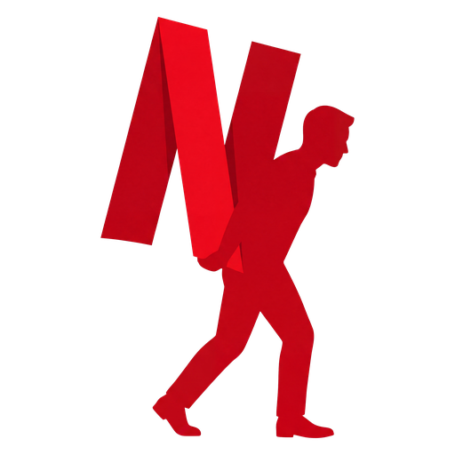
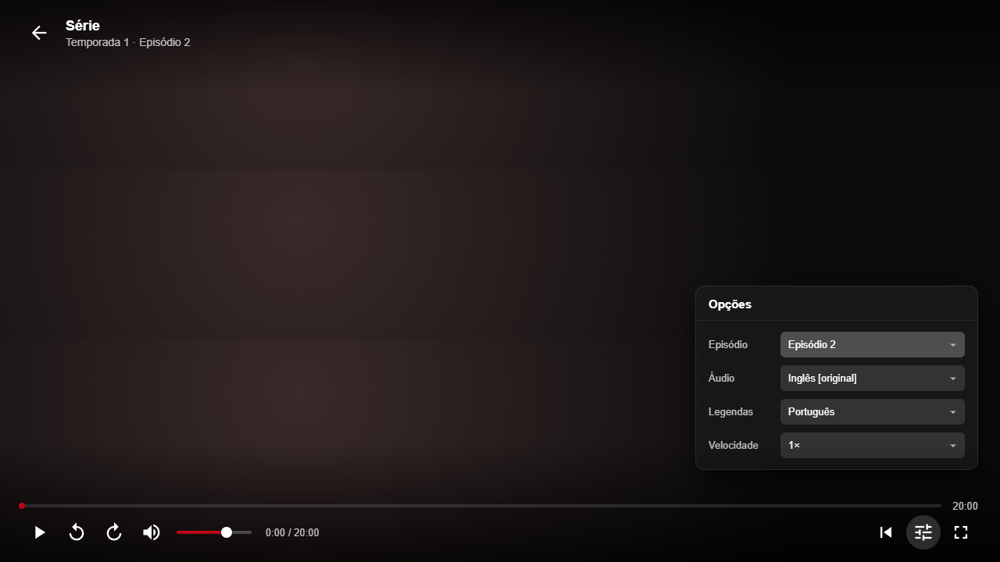
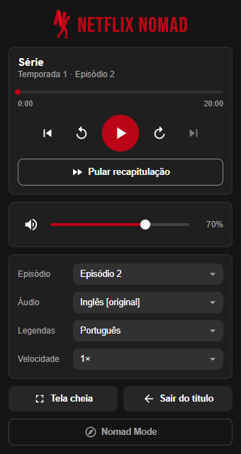

<div align="center">

<br>


**Controles completos para o player da Netflix: sobre o vídeo e na barra do navegador.**

[](https://github.com/joaocaioo/netflix-nomad/releases/latest/download/netflix-nomad-chrome.zip)
[](https://github.com/joaocaioo/netflix-nomad/releases/latest/download/netflix-nomad-firefox.zip)

[](https://github.com/joaocaioo/netflix-nomad/releases/latest)
[](https://github.com/joaocaioo/netflix-nomad/actions/workflows/ci.yml)
[](LICENSE)

</div>

---

<p align="center">
  
  &nbsp;
  
</p>

## Funcionalidades

### Sobre o vídeo

Os controles aparecem quando o mouse mexe e somem depois de 3 segundos parado, junto com o cursor.

- <picture><source media="(prefers-color-scheme: dark)" srcset="docs/icons/dark/play.svg"></picture> **Reproduzir e pausar**, também clicando em qualquer parte do vídeo
- <picture><source media="(prefers-color-scheme: dark)" srcset="docs/icons/dark/replay.svg"></picture> **Voltar e avançar 10 segundos**
- <picture><source media="(prefers-color-scheme: dark)" srcset="docs/icons/dark/timeline.svg"></picture> **Linha do tempo navegável**: passe o mouse para ver o tempo, clique ou arraste para ir até lá
- <picture><source media="(prefers-color-scheme: dark)" srcset="docs/icons/dark/skip.svg"></picture> **Pular recapitulação e abertura**, só quando há o que pular
- <picture><source media="(prefers-color-scheme: dark)" srcset="docs/icons/dark/next.svg"></picture> **Episódio anterior e próximo**
- <picture><source media="(prefers-color-scheme: dark)" srcset="docs/icons/dark/episodes.svg"></picture> **Qualquer episódio** de qualquer temporada
- <picture><source media="(prefers-color-scheme: dark)" srcset="docs/icons/dark/subtitles.svg"></picture> **Áudio e legendas**
- <picture><source media="(prefers-color-scheme: dark)" srcset="docs/icons/dark/volume.svg"></picture> **Volume e mudo**
- <picture><source media="(prefers-color-scheme: dark)" srcset="docs/icons/dark/speed.svg"></picture> **Velocidade** de 0,5× a 2×
- <picture><source media="(prefers-color-scheme: dark)" srcset="docs/icons/dark/fullscreen.svg"></picture> **Tela cheia**, com duplo clique no vídeo; `Esc` sai
- <picture><source media="(prefers-color-scheme: dark)" srcset="docs/icons/dark/exit.svg"></picture> **Sair do título**

### Na barra do navegador

- <picture><source media="(prefers-color-scheme: dark)" srcset="docs/icons/dark/popup.svg"></picture> **Popup** com os mesmos controles, para usar sem tirar o vídeo da tela
- <picture><source media="(prefers-color-scheme: dark)" srcset="docs/icons/dark/nomad.svg"></picture> **Nomad Mode**, sempre disponível em qualquer página da Netflix
- <picture><source media="(prefers-color-scheme: dark)" srcset="docs/icons/dark/keyboard.svg"></picture> **Atalhos do navegador**, configuráveis em `chrome://extensions/shortcuts`

## Instalação

### Chrome, Edge, Brave e Opera

1. Baixe o **[netflix-nomad-chrome.zip](https://github.com/joaocaioo/netflix-nomad/releases/latest/download/netflix-nomad-chrome.zip)** e extraia.
2. Abra `chrome://extensions`.
3. Ative o **Modo do desenvolvedor** (canto superior direito).
4. Clique em **Carregar sem compactação** e selecione a pasta extraída.
5. Fixe o ícone pelo 🧩 da barra.

### Firefox

1. Baixe o **[netflix-nomad-firefox.zip](https://github.com/joaocaioo/netflix-nomad/releases/latest/download/netflix-nomad-firefox.zip)**. Não precisa extrair.
2. Abra `about:debugging#/runtime/this-firefox`.
3. Clique em **Carregar extensão temporária** e selecione o `.zip`.

> No Firefox, a extensão temporária sai ao fechar o navegador.

### Atualizar

Baixe a versão nova, extraia por cima da pasta antiga, clique em ↻ no card da extensão em `chrome://extensions` e recarregue a aba da Netflix.

## Como usar

1. Abra a [Netflix](https://www.netflix.com) e dê play em um filme ou episódio.
2. Mexa o mouse sobre o vídeo para ver os controles, ou clique no ícone do **Netflix Nomad** na barra.

## Atalhos

### No player

| Tecla           | Ação                           |
| --------------- | ------------------------------ |
| `Espaço` ou `K` | Reproduzir / pausar            |
| `←` / `→`       | Voltar / avançar 10 segundos   |
| `↑` / `↓`       | Volume                         |
| `M`             | Mudo                           |
| `F`             | Tela cheia                     |
| `S`             | Pular recapitulação / abertura |
| `Esc`           | Sair da tela cheia             |

### Do navegador (com a aba da Netflix ativa)

| Atalho        | Ação                           |
| ------------- | ------------------------------ |
| `Alt+Shift+P` | Reproduzir / pausar            |
| `Alt+Shift+M` | Mudo                           |
| `Alt+Shift+S` | Pular recapitulação / abertura |
| `Alt+Shift+N` | Próximo episódio               |

Voltar e avançar 10 segundos ficam sem tecla padrão. Para definir ou trocar as teclas, abra `chrome://extensions/shortcuts`.

## Problemas comuns

| Mensagem ou sintoma                | Solução                                                           |
| ---------------------------------- | ----------------------------------------------------------------- |
| "A extensão ainda não está ativa"  | Recarregue a página da Netflix (`F5`).                            |
| "Abra um filme ou episódio"        | Os controles só aparecem no player, assistindo algo.              |
| "Controle não está disponível"     | Não há o que fazer agora (ex.: atalho de pular fora da abertura). |
| Os controles não aparecem no vídeo | Recarregue a página depois de instalar ou atualizar a extensão.   |

## Privacidade

O Netflix Nomad só acessa `netflix.com`. Ele não coleta, não guarda e não envia nenhum dado.

## Desenvolvimento

```bash
npm install
npm run dev        # abre o Chrome com a extensão e recarga automática
npm run build      # gera .output/chrome-mv3
npm run check      # typecheck, lint, formatação e testes unitários
npx playwright install chromium   # uma vez, para os testes de ponta a ponta
npm run test:e2e   # testes de ponta a ponta com Playwright
```

Feito com TypeScript, [WXT](https://wxt.dev), Preact, Vitest e Playwright.

<details>
<summary>Como funciona</summary>

- **`src/entrypoints/netflix.content/`**: content script na aba da Netflix. Atende o popup e os atalhos, e desenha os controles sobre o vídeo num Shadow DOM, isolado do CSS do site.
- **`src/entrypoints/netflix-api.ts`**: script injetado na própria página, onde existe a API interna do player da Netflix. Avançar, pular, trocar faixas e episódios passa por ela, e não pelos botões da Netflix, que nem sempre existem na página.
- **`src/entrypoints/popup/`**: o popup da barra do navegador.
- **`src/entrypoints/background.ts`**: atalhos globais e tela cheia da janela.
- **`src/lib/`**: regras sem interface, cobertas pelos testes unitários.
- **`src/ui/`**: componentes usados pelo popup e pelos controles sobre o vídeo.

</details>

### Publicar uma versão

```bash
npm version minor   # ou patch / major
git push --follow-tags
```

O GitHub Actions gera os `.zip` e cria a Release, e os botões de download passam a baixar a versão nova.

## Créditos

- Ícones: [Material Design Icons](https://fonts.google.com/icons) (Apache 2.0).
- Fonte do nome: [Bebas Neue](https://github.com/dharmatype/Bebas-Neue) (SIL Open Font License 1.1).

## Aviso

Projeto pessoal e sem fins comerciais, sem afiliação, patrocínio ou aprovação da Netflix. Netflix é uma marca registrada da Netflix, Inc.

## Licença

[MIT](LICENSE)
